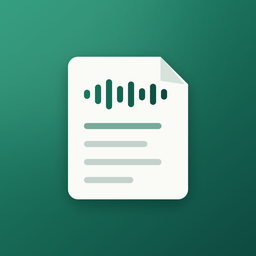
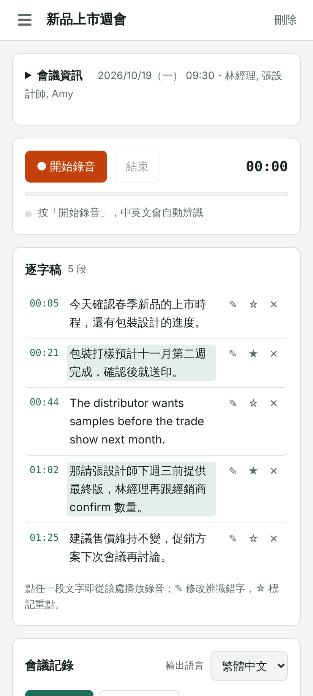
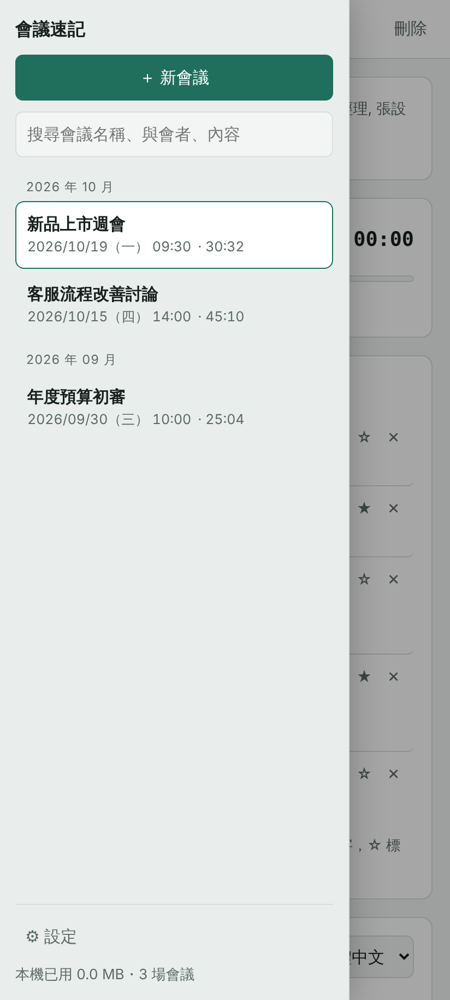
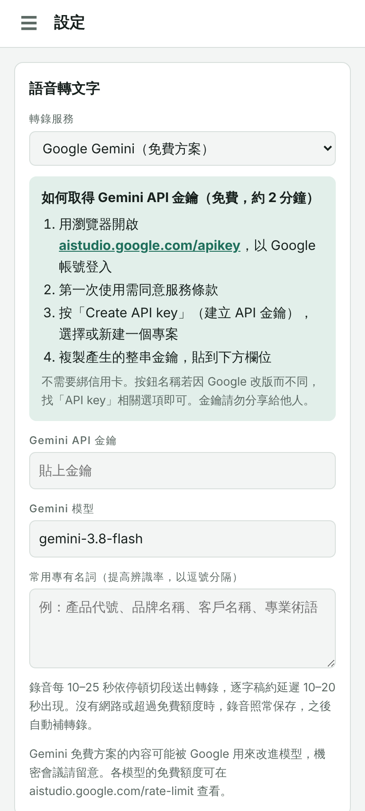

<p align="center"></p>

<h1 align="center">會議速記</h1>

<p align="center">中英文會議錄音 → 逐字稿 → 會議記錄，一支 Android App 完成。</p>

---

開會時按下錄音，App 會每隔 10–25 秒把錄音切成一小段送去轉錄，逐字稿陸續出現在畫面上，中英夾雜也能照原樣辨識。會議結束後一鍵整理成正式會議記錄：摘要、討論重點、決議事項、待辦事項（負責人／期限）、待確認事項。

每場會議的原始錄音都保存在手機裡。之後打開任何一場會議，點逐字稿的任一段就從那裡開始播放；播放時目前講到的段落會自動標亮。

<p align="center">
  
  
  
</p>

## 功能

### 錄音
- 開始／暫停／繼續／結束錄音，畫面顯示錄音時間與即時音量條
- 錄音時通知列常駐「錄音中」，螢幕關閉或切到其他 App 也會持續收音
- 錄音時預設保持螢幕開啟（設定 →「錄音」可關閉）
- 依說話停頓自動切段：滿 10 秒且停頓 0.5 秒就切一段，最長 25 秒強制切段；沒有人說話的片段不送轉錄，節省額度
- 每場會議同時保存完整原始錄音（約 32 kbps，一小時約 15 MB）
- App 在錄音中被關閉時，已錄下的部分會保留

### 轉錄逐字稿
- 中英夾雜自動辨識，不需切換語言；簡體結果自動轉為台灣繁體用語
- 轉錄服務可選 Google Gemini（免費方案）或 Groq Whisper
- 每段都帶時間點，對應回原始錄音
- 送出轉錄時附上前文與「常用專有名詞」，提高專有名詞與上下文的準確度
- 自動過濾語音模型常見的幻覺字句（例如「謝謝收看」、字幕來源等）
- 過短的片段自動合併成完整句子
- 待轉錄片段存在手機裡排隊：沒網路、額度用完或失敗時自動重試，恢復連線後自動補轉錄；連續失敗 3 次會顯示原因與「重試」按鈕

### 編修逐字稿
- ✎ 修改辨識錯字（Enter 儲存，清空即刪除該段）
- ☆ 標記重點，整理會議記錄時一定納入
- ✕ 刪除整段
- 顯示段數與轉錄進度（還有幾段待轉錄）

### 錄音播放與同步
- 會議結束後出現播放器，可拖曳進度
- 點逐字稿任一段，從該段開始播放
- 播放時目前段落標亮，並可自動捲動跟隨（可關閉）
- 顯示錄音長度與檔案大小

### 會議清單
- 左上 ☰ 開啟（平板寬螢幕固定顯示在左側）
- 依月份分組、依會議日期排序，顯示日期、星期與錄音長度
- 搜尋會議名稱、與會者、地點或逐字稿內容
- 標示「錄音中」與「待轉錄 N 段」
- 刪除會議需按兩次確認，錄音與逐字稿一併刪除
- 顯示本機已用空間與會議數
- 開啟 App 時自動回到上次使用的會議

### 會議資訊
- 會議名稱、日期時間、地點／形式、分類、與會者
- 收合時顯示日期（含星期）與與會者摘要

### 會議分類
- 在設定頁自訂分類（例如週會、客戶會議、專案檢討），可新增、改名、刪除
- 每場會議選一個分類；左側清單可依分類篩選，並顯示分類標籤
- 每個分類可設定自己的會議記錄格式，產生記錄時自動套用；沒設定就用預設格式

### 會議記錄
- 一鍵整理，服務可選 Google Gemini（免費）或 Claude
- 固定格式：會議資訊、會議摘要、討論重點、決議事項、待辦事項表（項目／負責人／期限／備註）、待確認事項
- 整理原則：忠於逐字稿、不補充未提及的事實；辨識不清處標「待確認」；負責人與期限沒提到就寫「未指定」；相對日期（如「下週三」）會換算成實際日期並標註星期
- 輸出語言：繁體中文、English 或中英對照
- 可重新產生、複製，或用 Android 分享選單傳到 LINE、Email 等
- 「複製提示詞」：不用 API，貼到 Claude App 整理
- 可設定轉錄完成後自動產生記錄

### 備份與還原
- 左上 ☰ →「備份與還原」
- 把設定與會議（錄音、逐字稿 .txt、會議記錄 .md）打包成一個 .zip，電腦上解壓縮即可直接查看
- 範圍可選全部會議或目前開啟的會議；可選擇不含錄音以縮小檔案
- API 金鑰預設不放進備份檔，需要時才勾選
- **存到手機**：存到「文件／會議速記」資料夾，移除 App 也不會刪除
- **分享／存到雲端硬碟**：從分享選單選「雲端硬碟」，存到 Google 雲端硬碟
- **還原**：選擇備份的 .zip；已存在的會議可選略過或覆蓋，可一併還原設定

### App 更新
- 每次開啟 App 都會自動檢查 GitHub 上的最新版本；有新版就自動下載並跳出安裝畫面，按「更新」即可，會議資料保留
- 錄音中不會打擾，錄音結束後才更新
- 側邊選單最下方或設定頁也可以手動「檢查更新」，並查看更新內容
- Android 規定從 Google Play 以外安裝的 App 不能在背景靜默更新，所以最後一步需要在系統畫面按「更新」；第一次會詢問是否允許「會議速記」安裝應用程式
- 不需要任何設定，也不需要 GitHub 帳號

### 設定
- 轉錄服務、整理服務、各服務金鑰與模型
- 設定頁內附 Gemini 金鑰申請步驟
- 金鑰只存在手機上

### 介面
- 支援深色模式（跟隨系統）
- 手機與平板版面自動調整

## 下載安裝

1. 用手機開啟本 repo 的 **[Releases](../../releases/latest)**
2. 下載最新的 `meeting-notes-v1.0.x.apk`
3. 開啟檔案，依提示允許「安裝未知應用程式」
4. 第一次按「開始錄音」時，允許麥克風權限

之後 App 每次開啟都會自動檢查，有新版就自動下載並跳出安裝畫面，按「更新」即可，會議資料與設定都會保留。

> 2026-10-20 更換過簽章金鑰。在這之前安裝的版本無法直接覆蓋：請先用「備份與還原」備份，移除舊 App，安裝最新版後再還原。

## 第一次設定：申請免費的 Gemini 金鑰

轉錄與會議記錄預設都使用 Google Gemini 的免費方案，共用同一把金鑰，不需綁信用卡。

1. 開啟 [aistudio.google.com/apikey](https://aistudio.google.com/apikey)，用 Google 帳號登入
2. 第一次使用需同意服務條款
3. 按「Create API key」，選擇或新建一個專案
4. 複製整串金鑰
5. 回到 App，左上 ☰ → 設定 → 貼到「Gemini API 金鑰」

App 的設定頁也有同樣的步驟說明。Google 改版時按鈕名稱可能不同，找「API key」相關選項即可。

## 使用方式

1. **建立會議**：☰ →「＋ 新會議」，填會議名稱、日期、地點、與會者（與會者名單有助於整理記錄時辨認負責人）
2. **錄音**：按「● 開始錄音」，可隨時暫停／繼續，結束時按「結束」
3. **檢查逐字稿**：修正錯字、把重要的句子標 ☆
4. **產生會議記錄**：按「產生會議記錄」；或按「複製提示詞」貼到 Claude App 整理
5. **回顧**：從 ☰ 選任何一場會議，點逐字稿或播放錄音

錄音時可以關閉螢幕或切到其他 App，通知列會顯示「錄音中」。從最近使用的 App 清單把會議速記滑掉會結束錄音。

## 設定選項

| 項目 | 選項 | 說明 |
|---|---|---|
| 轉錄服務 | Google Gemini（預設）／Groq Whisper | Groq 需另外申請金鑰 |
| Gemini 模型 | 預設 `gemini-3.8-flash` | 若顯示「找不到模型」，可改為 `gemini-3.5-flash-lite` |
| 常用專有名詞 | 以逗號分隔 | 轉錄時提供給模型參考 |
| 整理服務 | Google Gemini（預設）／Claude | Claude 需 Anthropic API 金鑰（付費） |
| 會議分類 | 自訂 | 每個分類可設定會議記錄格式 |
| 自動產生記錄 | 是／否 | 轉錄全部完成後自動整理 |

## 費用

| 項目 | 費用 |
|---|---|
| App 本身 | 免費 |
| Gemini 轉錄＋整理 | 免費方案內不收費；額度依 Google 規定，可在 [aistudio.google.com/rate-limit](https://aistudio.google.com/rate-limit) 查看 |
| Claude App 整理（複製提示詞） | 不需 API，使用既有的 Claude 帳號 |
| Groq／Anthropic API | 依各服務計費，選用 |

## 隱私與資料

- **存在哪裡**：錄音、逐字稿、會議記錄與 API 金鑰都存在 App 的私有空間，手機的檔案管理員看不到，也不會上傳到 GitHub 或其他地方。移除 App 或清除 App 資料會一併刪除，請定期用「備份與還原」備份。
- **送去哪裡**：錄音片段會傳到你選的轉錄服務；整理記錄時，逐字稿會傳到你選的整理服務。
- **Gemini 免費方案**：Google 可能使用免費方案的輸入與輸出內容來改進模型。涉及機密的會議請自行評估，或改用付費服務。

## 常見問題

**逐字稿一直沒出現？**
看逐字稿上方的狀態列。顯示「等待轉錄」代表尚未設定金鑰；顯示「失敗」可按「重試」。錯誤訊息會說明原因（金鑰無效、找不到模型、額度用完等）。

**顯示免費額度用完？**
錄音不會遺失，App 會每隔一段時間自動重試，額度恢復後就會補轉錄。

**換手機或要移除 App？**
先到「備份與還原」備份成 .zip（存到手機或雲端硬碟），在新手機安裝後選擇該檔案還原。

**圖示沒有更新？**
部分手機桌面會暫存舊圖示，重開機即可。

**辨識錯字很多？**
到設定頁加入常用專有名詞；錄音時手機盡量靠近發言者。

## 版本更新

目前版本：**v2.0.2**（2026-10-20）

完整版本紀錄請見 [docs/CHANGELOG.md](docs/CHANGELOG.md)；開發決策、架構與待辦請見 [docs/DEVELOPMENT_NOTES.md](docs/DEVELOPMENT_NOTES.md)。

## 開發

### 專案結構

```
www/index.html                  App 全部介面與邏輯（單一檔案，也能直接用瀏覽器開啟測試）
www/vendor/                     opencc-js（簡轉繁）、fix-webm-duration（錄音可拖曳）、JSZip（備份檔），MIT 授權
capacitor.config.json           App 名稱與 ID（tw.eddiehsu.meetingnotes）
assets/                         App 圖示原始檔（由 tools/make_icon.py 產生）
tools/make_icon.py              圖示產生腳本
.github/workflows/build-apk.yml 雲端編譯流程
docs/                           README 用的圖示與截圖
```

### 技術架構

- [Capacitor 7](https://capacitorjs.com/) 把 `www/` 包成 Android App
- 錄音：瀏覽器 MediaRecorder，同時錄完整音檔與依停頓切出的片段
- 儲存：IndexedDB（會議、錄音、待轉錄片段）
- 轉錄：Gemini `generateContent`（結構化 JSON 輸出，含每段時間）或 Groq Whisper `verbose_json`
- 外掛：`@capacitor-community/keep-awake`（錄音時螢幕不關）；自製原生外掛 `RecordingService`（`native/android/`，錄音前景服務）、`@capacitor/share`（分享記錄與備份檔）、`@capacitor/filesystem`（備份檔寫入「文件」資料夾、下載更新檔）、`@capacitor-community/file-opener`（開啟安裝程式）

### 編譯與發布

推送到 `main` 就會觸發 GitHub Actions（簽章金鑰與密碼從 Secret `SIGNING_KEYSTORE_BASE64`、`SIGNING_PASSWORD` 讀取，並檢查 APK 簽章指紋）：建立 Android 專案 → 加入麥克風權限 → 產生圖示 → 編譯 APK → 發布到 Releases（版號 `v1.0.<執行次數>`）。也可以在 Actions 頁面手動執行 **Build APK**。

本機開發：

```bash
npm install
npx cap add android
npx cap sync android
# 用 Android Studio 開啟 android/ 資料夾編譯
```

只修改 `README.md` 或 `docs/` 不會觸發編譯。版號由 `VERSION` 檔決定：版號不變時，編譯結果會覆蓋同一版 Release 的 APK；要發布新版時，先修改 `VERSION`，並在 `docs/CHANGELOG.md` 加上該版的更新內容（Release 說明會自動取用）。

修改介面時，直接用瀏覽器開啟 `www/index.html` 即可測試（Chrome 會使用電腦的麥克風）。

### 更新圖示

```bash
pip install pillow numpy
python3 tools/make_icon.py
```

### Fork 後自行編譯

簽章金鑰不在 repo 裡。Fork 後請自行產生一把金鑰（別名 `meetingnotes`），以 base64 存到 Secret `SIGNING_KEYSTORE_BASE64`、密碼存到 Secret `SIGNING_PASSWORD`，並把 `.github/workflows/build-apk.yml` 裡的 `EXPECTED` 憑證指紋改成你的金鑰指紋：

```bash
keytool -genkeypair -keystore my.keystore -storetype PKCS12 -alias meetingnotes -keyalg RSA -keysize 4096 -validity 20000 -dname "CN=My App"
base64 -w0 my.keystore    # 貼到 Secret
keytool -list -v -keystore my.keystore | grep SHA256
```

金鑰請自行妥善保存，遺失後新版將無法覆蓋安裝舊版。APK 以 debug 組態編譯，不適合直接上架 Google Play。
